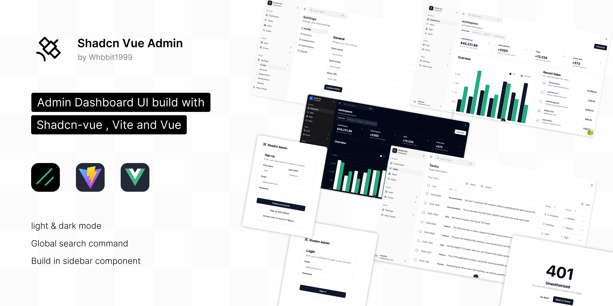

# Shadcn Vue Admin

[](https://github.com/antfu/eslint-config)
[](https://github.com/Whbbit1999/shadcn-vue-admin/blob/main/LICENSE)
[](https://vuejs.org/)
[](https://vitejs.dev/)
[](https://pnpm.io/)
[](https://www.typescriptlang.org/)

[English](./README.md) | 简体中文

基于 **shadcn-vue**、**Vue 3** 和 **Vite** 构建的前端 UI 模板，整合常用布局、组件与页面示例，方便按需定制和扩展。
本项目基于 [shadcn-admin](https://github.com/satnaing/shadcn-admin) 适配 Vue 实现。

[在线演示](https://shadcn-vue-admin.netlify.app/)



> 本仓库提供前端示例。登录采用模拟逻辑，任务列表等页面使用本地示例数据。用于生产环境前，需要接入自己的认证和业务 API。

## ✨ 核心特性

- ✅ 亮色、暗色及跟随系统的外观模式，支持主题设置持久化
- ✅ 全局搜索命令面板
- ✅ 基于 shadcn-vue 组件的侧边栏导航
- ✅ 仪表板、任务、用户、设置、认证及错误页等示例页面
- ✅ 基于 shadcn-vue 扩展的自定义组件库
- ✅ 基于文件结构的自动路由生成系统
- ✅ 基于 vue-i18n 的英文、简体中文语言资源（部分页面文案仍为硬编码）
- ✅ @tanstack/vue-form + Zod 表单验证
- ✅ 基于 TanStack Table 的可复用数据表格、TanStack Query 查询与变更示例，以及 Unovis 图表
- ✅ 流畅动画支持（AutoAnimate、Motion-V、TW Animate CSS）

## 🛠️ 技术栈与版本约束

| 分类             | 工具与库（主版本号）                                                                                                                                       |
| ---------------- | ---------------------------------------------------------------------------------------------------------------------------------------------------------- |
| 核心框架         | [Vue 3.5+](https://vuejs.org/), [TypeScript 6+](https://www.typescriptlang.org/)                                                                           |
| UI 组件          | [shadcn-vue](https://www.shadcn-vue.com), [reka-ui 2+](https://www.reka-ui.com/), [@lucide/vue](https://lucide.dev/)                                       |
| 构建工具         | [Vite 8+](https://vitejs.dev/), [@vitejs/plugin-vue 6+](https://github.com/vitejs/vite-plugin-vue)                                                         |
| 状态管理         | [Pinia 4+](https://pinia.vuejs.org/), [pinia-plugin-persistedstate 4+](https://prazdevs.github.io/pinia-plugin-persistedstate/)                            |
| 路由管理         | [vue-router 5+](https://router.vuejs.org/), [vite-plugin-vue-layouts 0.11+](https://github.com/JohnCampionJr/vite-plugin-vue-layouts)                      |
| 样式系统         | [Tailwind CSS 4+](https://tailwindcss.com/), [tw-animate-css 1+](https://github.com/Wombosvideo/tw-animate-css)                                            |
| 数据处理         | [TanStack Vue Query 5+](https://tanstack.com/query/latest), [TanStack Vue Table 9+](https://tanstack.com/table/latest)                                     |
| 表单验证         | [TanStack Vue Form](https://tanstack.com/form/latest/docs/overview), [Zod 4+](https://zod.dev/)                                                            |
| 动画效果         | [@formkit/auto-animate 0.10+](https://auto-animate.formkit.com/), [motion-v 2+](https://motion-v.vercel.app/)                                              |
| 国际化           | [vue-i18n 11+](https://vue-i18n.intlify.dev/)                                                                                                              |
| HTTP 客户端      | [ofetch](https://github.com/unjs/ofetch)                                                                                                                   |
| 代码规范与格式化 | [ESLint 10+](https://eslint.org/), [@antfu/eslint-config 9+](https://github.com/antfu/eslint-config)                                                       |
| 自动导入         | [unplugin-auto-import 21+](https://github.com/antfu/unplugin-auto-import), [unplugin-vue-components 32+](https://github.com/antfu/unplugin-vue-components) |

## 🚀 快速开始

### 环境要求

- `package.json` 声明 Node.js ≥ 22.15，CI 使用 Node.js 22。
- 使用 `package.json` 中 `packageManager` 指定的 pnpm 版本（当前为 **11.28.6**）。
- TypeScript 随项目依赖安装，无需全局安装。

### 安装步骤

1. 克隆仓库到本地

   ```bash
   git clone https://github.com/Whbbit1999/shadcn-vue-admin.git
   ```

2. 进入项目目录

   ```bash
   cd shadcn-vue-admin
   ```

3. 安装依赖

   ```bash
   pnpm install
   ```

4. 启动开发服务器

   ```bash
   pnpm dev
   ```

### 可用脚本

```bash
pnpm dev             # 启动开发服务器
pnpm build           # 生产构建（vue-tsc 类型检查 + vite 构建）
pnpm build:analyze   # 构建并生成包体积分析报告（ANALYZE=true）
pnpm preview         # 预览生产构建产物
pnpm lint            # 执行 ESLint 代码检查
pnpm lint:fix        # 自动修复代码规范问题
pnpm test            # 运行单元测试（监听模式）
pnpm test:run        # 运行单元测试（单次）
pnpm test:coverage   # 运行单元测试并生成覆盖率报告
pnpm release         # 使用 bumpp 升级版本
```

## 📖 高级指南

### 依赖维护

- `package.json` 声明依赖版本范围，`pnpm-lock.yaml` 记录解析后的版本。CI 使用 `pnpm install --frozen-lockfile` 安装依赖。
- 通过 `simple-git-hooks` 配置 Git 钩子：pre-commit 使用 `nano-staged` 修复暂存文件的 lint 问题，pre-push 执行 `pnpm build`。
- PR 包含 Markdown 以外的文件变更时，CI 执行 lint、构建和测试覆盖率检查。

### 主题定制

可参考 [tweakcn](https://tweakcn.com/editor/theme) 生成自定义主题。在 `src/assets/index.css` 的 `:root` 和 `.dark` 中调整基础 CSS 变量，按需修改 `@theme inline` 映射。主题选择器中的配色在 `src/assets/themes.css` 中还有独立覆盖；定制这些配色时，需要同步修改对应变量。

### 布局定制

如果希望 `pages/errors/` 和 `pages/auth/` 等目录下的页面不使用默认布局，可按以下步骤操作：

#### 步骤 1：创建目录级布局文件

在 `pages/` 目录下创建与子目录同名的文件，如 `src/pages/errors.vue` 和 `src/pages/auth.vue`，内容如下：

```vue
<template>
  <router-view />
</template>

<route lang="yml">
meta:
  layout: false # 禁用默认布局，适用于所有子路由
</route>
```

#### 步骤 2：配置目录入口跳转

项目中的 `src/pages/auth.vue` 和 `src/pages/errors.vue` 已采用上述结构。新建目录时，如果希望访问目录根路径后跳转到子页面，可在目录下添加 `index.vue`，例如 `src/pages/errors/index.vue`：

```vue
<script lang="ts" setup>
import { useRouter } from 'vue-router'

const router = useRouter()
// 示例：重定向至 404 页面
router.replace('/errors/404')
</script>
```

### API 配置

接入后端时，参考 `.env.example` 配置本地环境变量：

- `VITE_SERVER_API_URL`：后端服务地址。
- `VITE_SERVER_API_PREFIX`：API 路径前缀，默认为 `/api`。
- `VITE_SERVER_API_TIMEOUT`：请求超时时间，单位为毫秒，默认为 `5000`。

共享 ofetch 客户端位于 `src/lib/api-client.ts`，API 示例位于 `src/services/api/`。任务页面目前使用 `src/pages/tasks/data/tasks.json`，尚未接入任务 API 示例。

## 📄 许可证

本项目采用 **MIT 许可证**，详情请参阅 [LICENSE](https://github.com/Whbbit1999/shadcn-vue-admin/blob/main/LICENSE) 文件。

## 🤝 致谢

- **开发者**：[Whbbit1999](https://github.com/Whbbit1999)
- **原始设计**：[shadcn-admin](https://github.com/satnaing/shadcn-admin)
- **核心依赖**：shadcn-vue、Vue.js、Vite、Tailwind CSS
